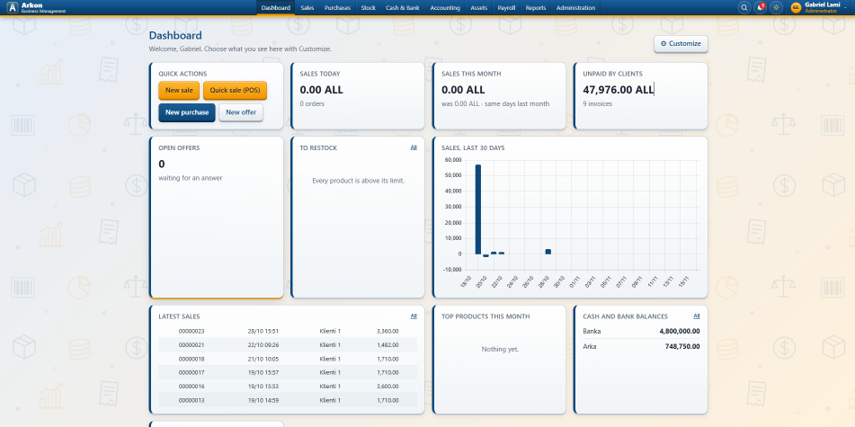

# Arkon – Sales, stock, finance and accounting in one place.


A web application for a small trading business: buy stock from merchants,
sell it to clients, send offers, print invoices, and follow stock, sales and
profit through reports and charts.

Arkon is the Java and Oracle version of the earlier ASP.NET Web Forms and
SQL Server "Financial Management System". Every page of the old system has
an equivalent here; see [Where each old page went](#where-each-old-page-went).

---

> **Using the app day to day?** See **[USER_GUIDE.md](USER_GUIDE.md)**: every option explained with
> examples (purchases, sales, offers, payments and debts, returns and stock adjustments, reports and
> statistics). This README covers what the app does and how to install and run it.

## Screenshot



The **Dashboard** has:
- quick actions: new sale, quick sale (POS), new purchase, new offer
- today's and this month's sales, and what clients still owe
- open offers and products that need restocking
- a 30-day sales chart, the latest sales and the top products
- cash and bank balances

You choose which cards appear with **Customize**.

---

## Contents

1. [What the app does](#what-the-app-does)
2. [Technology](#technology)
3. [Project layout](#project-layout)
4. [Build and run](#build-and-run)
5. [Configuration](#configuration)
6. [Start automatically at boot (Linux)](#start-automatically-at-boot-linux)
7. [Updating to a new version](#updating-to-a-new-version)
8. [Backups](#backups)
9. [Moving data from the old SQL Server system](#moving-data-from-the-old-sql-server-system)
10. [Database](#database)
11. [Troubleshooting](#troubleshooting)
12. [Where each old page went](#where-each-old-page-went)

---

## What the app does

### Logging in and roles

- Log in with a username and password. Passwords are stored as BCrypt hashes.
- There are two roles:

| Area | Administrator | User |
|---|---|---|
| New purchase, sale, offer | Yes | Yes |
| Order lists | All orders | Only their own |
| Edit or remove order lines | All orders | Only their own |
| Delete a whole order | Yes | No |
| Sale and offer invoices | View, download, delete | View, download |
| Purchase invoices | Yes | No |
| Reports and Statistics | Yes | No |
| Administration and Settings | Yes | No |
| Change own password | Yes | Yes |

- **Account menu:** the top-right corner shows your initials, full name and
  role. Click it to open:
  - a profile card (full name, username, role badge);
  - your previous login time;
  - language flags (🇦🇱 Shqip / 🇬🇧 English);
  - **Change password** and **Log out**.
- **Theme button:** the sun/moon button left of the username switches between
  the **light** and **dark** theme. The choice is remembered in that browser
  and applies to every page, including login. After a password change you are logged
  out and log in again with the new password.
- First login after installation: **admin / admin123**. Change it right away.

### Home

- **Eight tiles,** as in the old system: Purchases, Sales, Offerings, Reports,
  Invoices, Statistics, Administration, Classes. For regular users the
  administrator tiles are greyed out and marked "(Disabled)".

### Purchases, sales and offers

These three work the same way.

| | Provider | Buyer | Price used |
|---|---|---|---|
| Purchase | Merchant | Your company | Product buy price |
| Sale | Your company | Client | Product sale price minus the client's discount |
| Offer | Your company | Client, or a new client (tick **New client**) | As a sale; a new client gets a discount typed by hand |

**Order page** (Purchases/Sales/Offers → New …):

- **Header:** choose the provider and the buyer. Their TIN, address, email and
  phone appear underneath.
- **Offers to someone new:** tick **New client** under the client list, type
  the name, and fill in their contact details and a discount by hand. They are
  saved as a prospect, not as a client.
- **Price preview:** add products one at a time. One row shows price, unit,
  discount, unit price, value without VAT, VAT and value with VAT. It updates
  as you type.
- **Stock:** under Quantity you see how many units are in stock.
- **Stock rules:**
  - A sale or offer for more than the stock on hand is refused, with a clear
    message, and the Add product button is disabled.
  - The quantity limit is the **minimum stock to keep**. A sale or offer that
    would leave less than that in stock shows a warning, but can still be added.
- **Order numbers:**
  - Numbers count up: 00000001, 00000002, …, shared by purchases, sales and
    offers.
  - An order gets its number only when its first product is saved, so
    abandoned orders leave no gaps.
  - Once the first product is saved, the provider and buyer are fixed.
- **Invoice:** **Create invoice** makes a PDF in a modern layout, saved under
  Invoices. Creating it again replaces the earlier version.
  - **Design:** your logo and company details, a large title with the number,
    date and due date (or offer validity), a tinted **Bill to** box, and a
    highlighted **Amount due / Balance due** box.
  - **Items table:** quantity, unit price, discount (only when used) and amount.
  - **Totals:** subtotal, VAT with its rate and the total, plus paid and
    balance due when payments exist.
  - **Bottom:** a note with the payment terms, signature lines and a
    page-numbered footer.
  - **Colours and font:** the accent colour is the invoice colour from
    Settings. The font is Lato, embedded in the PDF, so Albanian letters
    (ë, ç) print correctly on any computer.

**Lists** (Purchases/Sales/Offers → List of …):

- **One row per order:** date, provider, buyer, items, values and the user
  who created it.
- **Totals row** at the bottom: the number of orders, items and values for
  everything matching the current search and dates (all pages). As on the old
  grids, the value without VAT is orange, the VAT red and the total green.
- **Live search:** results update as you type (order number, product, client
  or merchant). From/To dates and the number of rows apply as soon as they
  change. The Search button also works.
- **Paging and export:** pages of 10, 25, 50 or 100 rows, and Excel export
  (.xlsx) of the lines in the chosen date range.
- **Opening and deleting:** click a row to open the order. Administrators can
  delete a whole order.

### Payments and debts

- **Payments panel:** every sale and purchase has one, showing total, paid,
  still to pay and the due date (editable), plus a status: **Paid**,
  **Partly paid**, **Unpaid** or **Overdue**.
- **Recording payments:** record money received (sales) or paid (purchases)
  with a date, amount, method (cash, bank transfer, card, other) and a note.
  You can't record more than what's still owed. Administrators can delete a
  payment.
- **Payment column:** the Sales and Purchases lists show each order's
  payment status.
- **Debts pages:** **Reports → Unpaid by clients / Unpaid to merchants** list
  what's still owed, per client or merchant and per order, with overdue
  amounts first, and export to Excel.
- **Due dates:** they default to *payment terms* days after the order (Settings).

### Offers to sales

- **Offer panel:** each offer has a status (**Open**, **Accepted**,
  **Rejected**) and a **valid until** date. Open offers past that date show
  as **Expired**.
- **Turn into sale:** creates a new sale with the same products and the
  **offered prices**.
  - It checks stock for every line first, and refuses if anything is short.
  - An offer to a new contact registers them as a client automatically
    (administrators).
  - The offer is then marked as converted, with a link to the sale.
- **Statistics:** shows the share of offers that became sales.

### Returns and stock adjustments

- **Administration → Returns and stock adjustments:** records stock changes
  that aren't purchases or sales:
  - returned by a client;
  - returned to a merchant;
  - damaged;
  - lost or stolen;
  - a stock count that found more or less than recorded;
  - other.
- **Stock everywhere includes adjustments:** the sale stock check, product
  stock and the warehouse report (new **Adjusted** column).
- **Limits:** removing more than is in stock is refused. An adjustment can be
  undone.
- **Money is separate:** returns change stock only. Handle any refund
  separately.

### Real purchase cost and profit

- **Price paid:** a purchase line can have a **Price paid per unit** that
  differs from the product's buy price.
- **Cost on sales:** each sale line saves the product's **average purchase
  cost** at the time of sale. Statistics' profit uses it. Sales made before
  this feature use the current buy price.

### Barcodes

- **Product code:** products have an optional **barcode / product code**.
- **Scanning:** on order pages, scan or type it into **Scan or type code**.
  The product is selected and the cursor jumps to Quantity. A USB barcode
  scanner works as a keyboard, so no setup is needed.

### Audit log

- **Administration → Audit log** records who did what and when:
  - logins;
  - order lines added and removed, and orders deleted;
  - invoices created and deleted;
  - payments;
  - stock adjustments;
  - offer status and conversion;
  - products, clients, merchants, companies and users changed;
  - settings changes;
  - password changes.
- **Searching:** live, by text and date.
- **Clear all logs:** a button on the page. The clearing itself is recorded
  as the first entry of the fresh log.

### Home dashboard strip

- Above the tiles:
  - sales today;
  - unpaid client invoices (red when some are overdue);
  - products below their quantity limit (administrators);
  - open offers.
- **Links:** each figure opens the page behind it.
- **Regular users** see their own figures.

### Dashboard, roles and access

- **Personal dashboard (Paneli):** each user picks, removes and orders
  widgets from a catalogue (sales today and this month, a 30-day chart, top
  products, latest sales, unpaid amounts, open offers, returns, restock,
  purchase orders, cash balances, taxes to pay), or uses their role's
  default. Only widgets for areas they can access are offered.
- **Roles:** Administrator, User, and **Accountant** (view-only access to
  orders, reports, finances, taxes, payroll and assets, with export).
- **Per-user access:** each area can be set to no access, view only or full
  access, enforced on the server. The **Finance & Operations** tab groups
  payroll, assets, production and tax due.

### Optional modules

- **Settings → Modules** switches optional parts on and off. All are **off by
  default**; when off, their menus, pages and fields are hidden and their
  addresses answer "not found".
- **Modules so far:** Cash & Bank, Cost centres, Payroll, Fixed assets,
  Production, Tax due. The last four sit under the **More** tab.

### Statements, stock count, reminders, period lock, app (optional)

- **Client and supplier statements (kartela):** every invoice, return,
  payment and refund with a running balance; print and Excel.
- **Stock count (inventarizimi):** a snapshot of expected stock, a printable
  count sheet, counted quantities, and corrections applied in one go.
- **Notifications bell:** overdue and due-soon invoices, low stock and taxes
  due, depending on each user's access.
- **Payment reminder emails:** before and after the due date, sent by hand
  or automatically every morning, never twice.
- **Period lock:** nothing dated in a locked period can change.
- **Year-end closing:** in Accounting.
- **Installable app (PWA):** for phones and computers.

### Batches, expiry dates and serial numbers, optional

- **Tracking per product:** none, batch and expiry, or serial numbers.
- **Batches:** entered on purchases, first-expired-first-out on sales (or
  chosen), carried through returns, transfers and adjustments; an expiry
  report.
- **Serial numbers:** one per unit, received, sold, released and moved;
  a serial number lookup.

### Shops and warehouses, optional

- **Stock per location:** each sale, purchase, adjustment and count happens
  at a location; existing data belongs to the main one.
- **Transfers between locations:** with undo.
- **Stock-by-location table.**
- **Users** have their own shop, used for their sales and the POS.

### Quick sale (POS), optional

- **A fast checkout screen:** barcode scanning, a cart with +/−, cash or
  card with change.
- **One step:** the whole cart becomes one paid sale (all or nothing).
- **Printable receipt** for 80 mm printers. It's an internal receipt, not a
  fiscal one.

### VAT per client and per sale

- **Default:** the normal rate from Settings.
- **Optional overrides:** a client can have its own VAT rate and invoice
  note (e.g. 0% export), or one sale or offer can be changed before
  payment.

### Multi-currency (EUR, USD), optional

- **Exchange rates:** daily rates.
- **Orders:** sales, purchases and offers in EUR or USD at the order's rate.
  Payments are entered in that currency; invoices show the order currency
  plus the ALL total and VAT.
- **Cash & Bank accounts in EUR or USD**, and exchange transfers.
- **Automatic exchange differences:** each foreign-currency payment has a
  payment-day rate (daily, or typed in). Gains and losses are booked to
  769 / 669, with an Exchange differences report.
- **Reports and accounting:** everything is also stored in the base
  currency, so they keep working unchanged.

### Budgets, forecast, two-step login, price lists (optional)

- **Budgets per month vs actual results:** month and year to date, with a
  chart.
- **13-week cash-flow forecast:** from receivables, payables, taxes,
  salaries and budgeted expenses.
- **Two-step login (TOTP):** authenticator-app codes, optional or required;
  administrators can reset it. Uses the ZXing library for the QR code.
- **Price lists:** a price per product, assigned to clients and used on
  their sales and offers, with class discounts on top.

### Automatic backups, imports, labels, commissions

- **Automatic backups:** to any folder, every N hours or daily, full or data
  only, replaced or dated with retention.
- **Excel import:** products, clients, suppliers and opening stock, checked
  row by row before saving.
- **Bank statement import (CSV):** matched to movements and unpaid invoices,
  never imported twice.
- **Barcode labels:** EAN-13 / Code 128, rolls or A4 sheets.
- **Sales commissions per salesperson:** on sales or profit, optionally only
  paid sales.

### Official financial statements (Law 25/2018)

- **The four statements** in the official layout (position, performance,
  indirect cash flow, changes in equity), for a year and the year before,
  from the journal.
- **Excel export** into the official template, with the cover page and the
  account sheets.
- **The national chart of accounts** imported (inactive), with an editable
  statement line per account.

### Tax office VAT books, aging

- **VAT sales and purchase books** exported in the tax office's Excel format
  (version 4), filled into the original templates.
- **Purchases:** a **type** (local goods, imports, investments, farmers)
  that decides the purchase book columns, with a default per supplier, and
  the **supplier's invoice number**.
- **Aged receivables and payables:** not yet due, 1–30, 31–60, 61–90 and
  over 90 days.
- **Income statement and balance sheet** in Excel.

### Accounting (kontabilitet), optional

- **Chart of accounts:** following the Albanian classes, editable.
- **Automatic journal entries:** from sales, purchases, returns, payments,
  Cash & Bank, payroll, depreciation, stock adjustments, tax payments and
  opening balances. They're rebuilt per period on request, so they always
  match the data.
- **Manual entries:** with a debit = credit check.
- **Reports:** general ledger, trial balance, income statement, balance
  sheet, and the VAT sales and purchase books with NIPT, with Excel export.
- **Access:** the Accountant role has full access to Accounting by default.

### Payroll, Fixed assets, Production, Tax due (optional)

- **Payroll:** employees, and monthly payroll with contributions, income tax
  (TAP) and net. Rates and tax brackets are editable (Albania 2026
  defaults); paying the net can record "Salaries" in Cash & Bank.
- **Fixed assets:** register, straight-line or declining depreciation, book
  value on any date, disposal.
- **Production:** bills of materials, and production orders that use up
  components and add finished goods at their production cost.
- **Tax due:** VAT (sales − purchases) and payroll taxes per month, with
  due dates, payments and status; paying can record "Taxes" in Cash & Bank.

### Cash & Bank (Arka & Banka), optional

- **Accounts:** cash registers and bank accounts, with opening balances.
  "Arka" and "Banka" are created automatically.
- **Payments:** payments and refunds on sales and purchases become movements
  automatically. Cash goes to Arka, bank transfer or card to Banka, or the
  account chosen on the payment.
- **Manual entries:** other money in (capital, loans, other income) and out
  (rent, salaries, utilities, transport, taxes, bank fees, owner withdrawals,
  loan repayments, other expenses).
- **Transfers:** between accounts.
- **Reconciliation:** against a cash count or bank statement.
- **Analytics:** month vs previous month or the same month last year, the
  year so far vs last year (with change %), per-category comparison, and
  12-month charts against the year before.
- **Views:**
  - **Overview:** the balance per account.
  - **Movements:** a ledger with running balance and Excel export.
  - **Cash flow:** a report by category, with a chart.

### Cost centres (qendra e kostos), optional

- **Assigning:** sales and purchases are assigned per order; other income
  and expenses per Cash & Bank entry.
- **Report:** revenue, cost of goods, gross profit, purchases, other income,
  expenses and **result** per cost centre, compared with the previous period.

### Returns, credit notes and refunds

- **Sales and purchases:** returns are recorded on the order itself as minus
  lines, with a **reason**. Clients returning goods: stock goes up. Returns
  to merchants: stock goes down. Order totals, reports, statistics, profit
  and debts all follow.
- **Documents:** each return creates a credit note (sales) or return note
  (purchases) PDF.
- **Refunds:** recorded in Payments when money was already paid.
- **Lists:** **Sales returns** and **Returns to merchants** list every
  return.
- **Statistics:** a **Returns** section shows the most returned products,
  clients, merchants and reasons.

### Purchase orders

- **Created from** the warehouse **For supply** list (tick products, adjust
  quantities, choose the merchant).
- **Sending:** PDF, and email to the merchant when email is on.
- **Stock:** unchanged until **Goods received**, which creates the real
  purchase.

### Backup and restore

- **Where:** Administration → **Backup and restore**.
- **Export:** one `.zip` with all data, invoice PDFs and logo. The browser
  asks where to save it.
- **Restore:** replaces all data in one transaction, after saving a safety
  copy under `backups/`.

### Invoice language

- **Setting:** invoices, credit notes, purchase orders and pick lists print
  in **Shqip** or **English** (Settings).

### Email invoices

- **Optional:** when email is switched off, nothing about it shows.
- **Sending:** when email is on, sales and offers have an **Email invoice**
  panel that creates the invoice PDF and sends it to the client, with an
  optional message.
- **Setup:** the mail server is set up in the app under **Administration →
  Email settings** (server, port, security, username, password, sender), with
  a **Send test email** button. No configuration files are needed. With email
  switched on, every field is required; missing ones are listed on save.
- **Logging:** every email sent is recorded in the audit log.

### Shelves and pick lists

- **Shelves (optional, off by default):** Administration → **Shelves** records where stock
  physically is (e.g. A1: 2, A2: 3). Switch shelves off in Settings to hide
  them completely. When on, sales choose the shelf to take from.
- **Purchases and sales:** purchases can put goods on a shelf, and sales
  choose the shelf to take from, which updates the shelf quantity.
- **Kept in sync:** adjustments, removed lines and deleted orders update the
  shelves too.
- **Pick list:** each sale has a printable **Pick list** and a **Pick list
  PDF** with the sale number, items, product codes, quantities and shelves,
  for the person collecting the goods.

### Statistics chart chooser

- **⚙ Charts:** on the Statistics page, choose which charts and figure blocks
  to show, or **Show all** / **Hide all**.
- **Remembered:** the choice is kept per browser.

### Column chooser

- **Every grid:** a **☰ Columns** button shows or hides columns, with **Show
  all**.
- **Remembered:** the choice is kept per page in the browser.
- **Totals:** totals rows stay aligned with the visible columns.

### Language

- **English or Albanian (Shqip):** switch with the flag buttons in the account
  menu (top right) or on the login page. The choice is remembered on that computer.
- **What's translated:** everything on screen: menus, pages, grid columns,
  buttons, field hints, statuses (payment, offer), payment methods, stock
  reasons, confirmation questions, the live warnings on order pages, chart
  labels, and the short messages after saving.
- **Still English:**
  - Messages that contain a name or number, such as "Not enough stock: you
    entered 10 …". The order page's own live warning is translated and
    normally appears first.
  - Invoice PDFs, Excel exports and audit-log entries.
- **Where the texts are:** `src/main/resources/messages.properties` (English)
  and `messages_sq.properties` (Albanian). Edit a line there to change a
  wording, then rebuild.

### Invoices

- Saved PDFs for purchases (administrators only), sales and offers.
- Live search by file name (client, date or order number).
- Open the PDF in the browser or download it. Administrators can delete.

### Reports (administrators)

- **Purchases report / Sales report:** totals for today, this month and this
  year side by side, plus a chosen period (today, month, year or custom dates)
  with all its lines and totals. Excel export and print.
- **Products report:** every sale and purchase of a product (search by product
  name or order number, live). Shows units bought, sold and remaining.
- **Warehouse report,** two views:
  - **Warehouse inventory:** per product, units purchased and sold in the
    period, units remaining, sale price and stock value, with the total value.
  - **For supply:** products to restock, meaning those whose remaining stock
    is below their quantity limit or less than *N* units above it (you set
    *N*, default 3).

  Both views export to Excel.

### Statistics (administrators)

A dashboard for a chosen period (today, this month, this year or custom).

**Headline figures:**
- Sales and purchases totals.
- Estimated gross profit and margin, at current buy prices.
- Average sale, number of orders, items sold and offers made.

**Charts:**
- **Sales, purchases and offers over time:** per day for short periods, per
  month for longer ones.
- **Which client bought more:** pie chart.
- **Which product was sold more:** units, column chart.
- **Who sold more:** sales per user.
- **Products that earned the most:** by value.
- **Sales by product class:** doughnut chart.

**Excel export:** one workbook with a sheet per chart and a summary sheet.

The charts use Chart.js, bundled inside the app, so they work without internet
access.

### Administration (administrators)

- **Merchants, Clients, Companies:** name, TIN, address, email, phone.
- **Products:**
  - Name, unit, buy price, sale price and quantity limit (minimum stock to
    keep: used for the sale warning and the For supply report).
  - A discount class. The list shows each product's current stock.
- **Product classes and discounts:**
  - Group products into classes.
  - Give each client a discount % per class.
  - Sales and offers apply the right discount automatically.
- **Users:** add, edit, delete, set role and set password.
- **Settings:**
  - Money and invoices: currency, VAT %, and the invoice accent colour.
  - Invoice logo: upload, replace or remove.
  - Background: the two pastel gradient colours, watermark strength, and
    panel opacity, with a live preview and a reset to default.

### Look and feel

- **Every page:** a pastel two-colour background with a faint watermark of
  inventory and finance icons (boxes, coins, charts, receipts, barcode, scale).
  It is adjustable under Settings.
- **Menu bar:** navy and amber, as in the old system. Tabs are centred and
  open on hover with a mouse, or by click, touch or keyboard.
- **Old icons:** your original icons are used for delete, Excel, PDF and
  download buttons, and for the favicon.
- **Screens and printing:** responsive from wide monitors down to phones.
  Below about 1380 px the menu folds into a ☰ button, and on phones forms
  and filters stack into full-width rows. The background and menus are left
  out when printing.

---

## Technology

| Part | Technology | Version |
|---|---|---|
| Language | Java | 17 or newer (built for 17, runs on 21) |
| Build tool | Apache Maven | 3.6.3 or newer |
| Application framework | Spring Boot | 3.3.5 |
| Web layer | Spring MVC (controllers), embedded Tomcat | from Spring Boot |
| Pages | Thymeleaf server-side templates, plain HTML/CSS/JavaScript | from Spring Boot |
| Login and roles | Spring Security (form login, BCrypt passwords, CSRF protection) | from Spring Boot |
| Data access | Spring Data JPA with Hibernate ORM | Hibernate 6.5 |
| Database | Oracle Database | 12.2 or newer (tested on 23ai Free) |
| Database driver | Oracle JDBC `ojdbc11` | from Spring Boot |
| Schema migrations | Flyway (with the Oracle module) | 10.x, from Spring Boot |
| Invoice PDFs | OpenPDF (open-source fork of iText) | 1.3.30 |
| Invoice font | Lato (SIL Open Font License, bundled in `src/main/resources/fonts`) | 2.x |
| Excel export | Apache POI (`.xlsx`) | 5.2.5 |
| Charts | Chart.js, bundled in the app | 4.4.1 |
| Validation | Jakarta Bean Validation (Hibernate Validator) | from Spring Boot |

The whole app builds into **one runnable `.jar` file** that contains the web
server. You don't install Tomcat, IIS or any other web server.

---

## Project layout

```
pom.xml                        Maven build: dependencies and versions
README.md                      This file
migration/
  export_from_sqlserver.sql    Turns old SQL Server data into Oracle INSERTs
src/main/java/com/fms/
  FmsApplication.java          Starts the app
  config/                      Security, password hashing, settings binding
  domain/                      Database entities (one per table)
  repo/                        Database queries (Spring Data repositories)
  service/                     Business rules: pricing, stock, orders, invoices,
                               reports, statistics, Excel, files, users
  web/                         Page controllers and form objects
src/main/resources/
  application.yml              Configuration (database, port, storage folder)
  db/migration/                Flyway database scripts V1–V4
  templates/                   Thymeleaf pages (fragments/layout.html = menu)
  static/css/app.css           All styling
  static/js/                   common.js (live search, confirmations),
                               order.js (price preview), statistics.js (charts),
                               vendor/chart-4.4.1.umd.min.js
  static/img/                  Icons, watermark pattern (pattern.svg)
```

---

## Build and run

These steps are for **Debian or Ubuntu**, including **WSL** on Windows.

### 1. Install Java, Maven and Docker

```bash
sudo apt update
sudo apt install -y openjdk-21-jdk maven unzip     # Debian 13: Java 21
# Ubuntu 22.04/24.04 can use openjdk-17-jdk instead
java -version
mvn -version
```

Docker is only needed if you run Oracle in a container on the same machine.
See https://docs.docker.com/engine/install/ for your system.

### 2. Start an Oracle database

For development or a small single-server setup, Oracle Database Free in Docker
works well. The named volume keeps the data even if the container is removed:

```bash
docker run -d --name fms-oracle \
  --restart unless-stopped \
  -p 1521:1521 \
  -v ims-oracle-data:/opt/oracle/oradata \
  -e ORACLE_PASSWORD=ChangeThisSysPassword \
  -e APP_USER=INVENTORY -e APP_USER_PASSWORD=ChangeThisAppPassword \
  gvenzl/oracle-free:23-slim

docker logs -f fms-oracle      # wait for: DATABASE IS READY TO USE!
```

`--restart unless-stopped` makes Docker start the database again after a
reboot.

**Already have a container without these options?**
- **Restart policy:** add it without losing anything:
  `docker update --restart unless-stopped fms-oracle`
- **Volume:** the data lives inside the container. It survives restarts, but
  not `docker rm`. Back it up before you ever recreate the container (see
  [Backups](#backups)).

**Using an existing Oracle server instead?** Create a user for the app:

```sql
CREATE USER INVENTORY IDENTIFIED BY "a-strong-password"
  DEFAULT TABLESPACE USERS QUOTA UNLIMITED ON USERS;
GRANT CREATE SESSION, CREATE TABLE, CREATE SEQUENCE, CREATE VIEW TO INVENTORY;
```

### 3. Build

From the project folder (the one that contains `pom.xml`):

```bash
cd ~/fms
mvn package -DskipTests
```

The first build downloads all libraries and takes a few minutes. The result is
`target/financial-management-system-1.0.0.jar`.

### 4. Run

```bash
export DB_URL=jdbc:oracle:thin:@//localhost:1521/FREEPDB1
export DB_USER=INVENTORY
export DB_PASSWORD=ChangeThisAppPassword
export FMS_STORAGE_DIR=$HOME/ims-data

java -jar target/financial-management-system-1.0.0.jar
```

- **Started:** wait for `Started FmsApplication` in the log.
- **First start:** Flyway creates all tables automatically.
- **Open it:** go to http://localhost:8080 and log in as **admin / admin123**.
  Change that password straight away.
- **Stop it:** press Ctrl+C.

Running it this way, the app stops when you close the terminal. To keep it
running, and have it start by itself after a reboot, set it up as a service:
see [Start automatically at boot](#start-automatically-at-boot-linux).

---

## Configuration

Settings come from environment variables. You can also edit
`src/main/resources/application.yml` and rebuild.

| Variable | Meaning | Default |
|---|---|---|
| `DB_URL` | Oracle JDBC URL, `jdbc:oracle:thin:@//HOST:PORT/SERVICE` | `jdbc:oracle:thin:@//localhost:1521/FREEPDB1` |
| `DB_USER` | Database user | `INVENTORY` |
| `DB_PASSWORD` | Database password | `change_me` |
| `FMS_STORAGE_DIR` | Folder for invoice PDFs and the logo | `./data` |
| `PORT` | Web port | `8080` |

Use an **absolute path** for `FMS_STORAGE_DIR` (e.g. `/var/lib/ims/data`).
A relative path depends on the folder the app was started from.

In-app settings (currency, VAT, invoice colour, logo, payment terms, offer
validity, background) are stored in the database and changed under
**Administration → Settings**.


## Start automatically at boot (Linux)

This runs Arkon as a **systemd service**:
- **At boot:** it starts by itself.
- **After a crash:** it restarts automatically.
- **When you log out:** it keeps running.
- **Logs:** they go to the system journal.

### 1. Put the app in a fixed place

```bash
sudo useradd --system --home /opt/ims --shell /usr/sbin/nologin ims   # service account
sudo mkdir -p /opt/ims /var/lib/ims/data /etc/ims
sudo cp ~/fms/target/financial-management-system-1.0.0.jar /opt/ims/ims.jar
sudo chown -R ims:ims /opt/ims /var/lib/ims
```

To keep invoices and the logo from your test runs, copy them across too:
`sudo cp -r ~/fms/data/* /var/lib/ims/data/ && sudo chown -R ims:ims /var/lib/ims`

### 2. Store the settings, readable only by root

```bash
sudo tee /etc/ims/ims.env > /dev/null <<'EOF'
DB_URL=jdbc:oracle:thin:@//localhost:1521/FREEPDB1
DB_USER=INVENTORY
DB_PASSWORD=ChangeThisAppPassword
FMS_STORAGE_DIR=/var/lib/ims/data
PORT=8080
EOF
sudo chmod 600 /etc/ims/ims.env
```

### 3. Create the service

```bash
sudo tee /etc/systemd/system/ims.service > /dev/null <<'EOF'
[Unit]
Description=Arkon – Business Management
# Start after the network, and after Docker if Oracle runs in a container here.
After=network-online.target docker.service
Wants=network-online.target

[Service]
Type=simple
User=ims
Group=ims
WorkingDirectory=/opt/ims
EnvironmentFile=/etc/ims/ims.env
ExecStart=/usr/bin/java -Xms256m -Xmx768m -jar /opt/ims/ims.jar
# If the database isn't ready yet at boot, the app exits; this retries it.
Restart=always
RestartSec=15
SuccessExitStatus=143

[Install]
WantedBy=multi-user.target
EOF
```

### 4. Enable and start it

```bash
sudo systemctl daemon-reload
sudo systemctl enable --now ims
systemctl status ims          # should say: active (running)
```

### Everyday commands

| Task | Command |
|---|---|
| Status | `systemctl status ims` |
| Live log | `journalctl -u ims -f` |
| Recent errors | `journalctl -u ims -p err --since today` |
| Restart | `sudo systemctl restart ims` |
| Stop | `sudo systemctl stop ims` |
| Don't start at boot | `sudo systemctl disable ims` |

### The database at boot

- **Oracle in Docker:** the container must have `--restart unless-stopped` (or
  run `docker update --restart unless-stopped fms-oracle`). Docker itself must
  start at boot: `sudo systemctl enable docker`.
- **Oracle on another server:** nothing to do on this machine.
- **Boot order:** if Arkon starts before Oracle is ready, it exits and systemd
  tries again every 15 seconds until the database answers.

### Running inside WSL (Windows)

On WSL, systemd must be switched on first:

```bash
sudo tee /etc/wsl.conf > /dev/null <<'EOF'
[boot]
systemd=true
EOF
```

1. **Restart WSL:** run `wsl --shutdown` in Windows PowerShell, then open your
   Linux terminal again.
2. **Set up the service:** follow the four steps above.

WSL itself only starts when something opens it, not when Windows starts. To
have Arkon available after a Windows reboot without opening a terminal:

1. **Open Task Scheduler:** in Windows, open Task Scheduler and choose
   **Create Task**.
2. **Trigger:** At log on, or At startup.
3. **Action:** start a program, `wsl.exe`, with the arguments
   `-d Debian -u root -e sleep infinity`.
4. **Distribution name:** use yours; `wsl -l` lists them.

WSL then starts in the background, systemd starts Docker and Arkon, and the app
is at http://localhost:8080. For a real business deployment, use a Linux
server or virtual machine rather than WSL.

### Optional: HTTPS and a proper address

To serve Arkon at e.g. `https://ims.yourcompany.al`:

1. **Put a reverse proxy in front:** use nginx (or IIS on Windows) in front of
   port 8080 to handle the certificate.
2. **Tell the app it's behind a proxy:** add this to `application.yml` so
   redirects and login use the right address:

```yaml
server:
  forward-headers-strategy: framework
```

---

## Updating to a new version

```bash
cd ~/fms
unzip -o /path/to/fms-java-oracle.zip -d ~/fms      # or git pull
mvn package -DskipTests
sudo cp target/financial-management-system-1.0.0.jar /opt/ims/ims.jar
sudo systemctl restart ims
journalctl -u ims -f        # watch it start; Flyway applies any new database scripts
```

- **Database changes:** applied automatically on start. Never edit a migration
  that has already run (V1–V4); changes always go in a new `V5__…` file.
- **Browser cache:** press Ctrl+F5 after an update if a page looks old.

---

## Backups

Back up two things:

1. **The database (Oracle schema `INVENTORY`)**

   With Oracle in Docker:

   ```bash
   # once: allow the app user to use the export folder
   docker exec -i fms-oracle sqlplus -s system/ChangeThisSysPassword@FREEPDB1 <<'EOF'
   GRANT READ, WRITE ON DIRECTORY DATA_PUMP_DIR TO INVENTORY;
   EOF

   # each backup
   docker exec fms-oracle expdp INVENTORY/ChangeThisAppPassword@FREEPDB1 \
     schemas=INVENTORY directory=DATA_PUMP_DIR dumpfile=ims_$(date +%F).dmp logfile=ims_$(date +%F).log
   docker cp fms-oracle:/opt/oracle/admin/FREE/dpdump/ ./ims-db-backup-$(date +%F)/
   ```

   If the `docker cp` path differs on your image, find the folder with:
   `docker exec fms-oracle sqlplus -s system/…@FREEPDB1 <<< "select directory_path from all_directories where directory_name='DATA_PUMP_DIR';"`

   On a company Oracle server, ask the DBA to include the `INVENTORY` schema
   in the normal backups.

2. **The files folder:** invoice PDFs and the logo.

   ```bash
   sudo tar czf ims-files-$(date +%F).tar.gz -C /var/lib/ims data
   ```

Keep copies on another machine. Test a restore once in a while.

---

## Moving data from the old SQL Server system

1. **Create the tables:** start Arkon once against an empty Oracle user so
   Flyway creates them.
2. **Export from SQL Server:** in SSMS, run `migration/export_from_sqlserver.sql`
   against `InventorySysDB` with **Results to Text**. The steps are in the
   script header; it needs SQL Server 2016+.
3. **Import into Oracle:** save the output as `import.sql` and run it in
   SQL Developer or SQL*Plus as `INVENTORY`. It replaces the default `admin`
   account with your old users.
4. **Copy the files** from the old IIS site into the storage folder:

   | Old folder | New folder |
   |---|---|
   | `InvoicesPrint/Purchase Invoice/` | `invoices/purchases/` |
   | `InvoicesPrint/Sales Invoice/` | `invoices/sales/` |
   | `InvoicesPrint/Offers Invoice/` | `invoices/offers/` |
   | `Logo/` | `logo/` |

5. **Old passwords:** users log in with their old passwords. Each one is
   converted to a secure BCrypt hash on that first login.

### What the import cleans up

- **Amounts:** text amounts like "1,200" become numbers.
- **Product classes:** `PClasses.Products` (a text list) becomes a link from
  each product to its class.
- **Client discounts:** `CClass`, which had one column per class, becomes
  discount rows.
- **Orders:** Purchases, Sales and Offers go into one `ORDER_LINE` table with
  an order type.
- **Order numbers:** new orders count from 00000001 and skip any number
  already used by an imported order.

### Check afterwards

- **Totals:** compare order counts and yearly totals in Reports with the old
  system.
- **Discounts:** spot-check a few client discounts under Classes.

---

## Database

Flyway scripts in `src/main/resources/db/migration`:

| Script | What it does |
|---|---|
| `V1__schema.sql` | All tables, indexes and the order-number sequence |
| `V2__seed.sql` | Default settings row and the `admin` user |
| `V3__order_numbers_from_1.sql` | Order numbers start at 00000001 |
| `V4__background_settings.sql` | Background colours and opacity settings |
| `V30__fx_revaluation.sql` | Year-end exchange rate adjustment |
| `V29__backups_import_bank_labels_commissions.sql` | Automatic backups, bank statement import, sales commissions |
| `V28__record_visibility_sharing.sql` | Which records each user sees; sharing records (view only) |
| `V27__official_statements.sql` | Official chart of accounts, statement lines, cover details |
| `V26__payroll_2026_rules.sql` | Payroll as the official 2026 list |
| `V25__purchase_type_supplier_invoice.sql` | Purchase type (with a default per supplier) and supplier invoice number |
| `V24__vat_book_column.sql` | Client's sales-book column for 0% sales |
| `V23__batches_serials.sql` | Batch / expiry and serial number tracking per product |
| `V22__locations.sql` | Shops and warehouses: stock per location, transfers |
| `V21__pos.sql` | Quick sale (POS) module and its settings |
| `V20__vat_per_client_and_sale.sql` | VAT rate and invoice note per client and per sale/offer |
| `V19__exchange_differences.sql` | Payment-day rate, exchange gains/losses (769, 669) |
| `V18__currencies.sql` | Multi-currency: rates, order and account currencies (module off) |
| `V17__budgets_2fa_price_lists.sql` | Budgets, two-step login, price lists (modules off) |
| `V16__statements_count_reminders_lock_pwa.sql` | Statements, stock count, reminders, period lock, installable app (modules off) |
| `V15__accounting.sql` | Accounting: chart of accounts, journal entries (module off) |
| `V14__roles_access_dashboard.sql` | Accountant role, per-user access, personal dashboards |
| `V13__payroll_assets_production_taxes.sql` | Payroll, fixed assets, production, tax due (modules off) |
| `V12__modules_cost_centers.sql` | Module switches (all off), cost centres |
| `V11__cash_and_bank.sql` | Cash & Bank accounts and movements (existing payments carried over) |
| `V10__return_reasons_shelves_default_off.sql` | Return reasons; shelves off by default |
| `V9__returns_invoice_language_purchase_orders.sql` | Returns on sales, refunds, invoice language, purchase orders |
| `V8__email_settings.sql` | Email server settings |
| `V7__shelves_optional.sql` | Setting to switch shelves on or off |
| `V6__shelves.sql` | Shelves, shelf stock, and the shelf used on order lines and adjustments |
| `V5__payments_returns_offers_audit.sql` | Payments, order due dates and offer status, stock adjustments, purchase cost, product codes, audit log, payment terms |

| Table | Contents |
|---|---|
| `APP_USER` | Users, BCrypt passwords, role (1 = Administrator, 2 = User), last login |
| `MERCHANT`, `COMPANY`, `CLIENT` | Suppliers, your own companies, customers |
| `PROSPECT` | Offer recipients who aren't clients |
| `PRODUCT`, `PRODUCT_CLASS` | Products and their discount classes |
| `CLIENT_CLASS_DISCOUNT` | Discount % per client per class |
| `ORDER_LINE` | All purchase, sale and offer lines (`ORDER_TYPE`, `ORDER_CODE`) |
| `APP_CONFIG` | Currency, VAT, invoice colour, logo, background, payment terms, offer validity |
| `ORDER_INFO` | Per order: payment due date; for offers status, valid-until and the sale it became |
| `PAYMENT` | Payments received (sales) and made (purchases) |
| `STOCK_ADJUSTMENT` | Returns, damage, losses, stock-count corrections (signed quantity) |
| `AUDIT_LOG` | Who did what and when |
| `SHELF`, `SHELF_STOCK` | Shelves and how many units of each product are on each |

Order lines store product, merchant and client **names** as they were at the
time, so old invoices stay correct if something is renamed later. Stock is
counted by product name, so renaming a product starts its stock count from
zero.

---

## Troubleshooting

| Problem | Cause and fix |
|---|---|
| `mvn: command not found` | Install Maven: `sudo apt install maven` |
| `there is no POM in this directory` | Run Maven inside the project folder, the one with `pom.xml` |
| `Unable to access jarfile` | Build first (`mvn package -DskipTests`), or use the full path to the jar |
| App exits at start with a database connection error | Oracle isn't running or not ready. Check `docker ps`, then `docker logs fms-oracle`. Check `DB_URL`, user and password |
| `ORA-01017: invalid username/password` | Wrong `DB_USER` / `DB_PASSWORD` |
| Port 8080 already in use | Another copy is running (`systemctl status ims`), or set `PORT=8081` |
| Can't log in as admin after importing old data | The import replaces `admin` with your old users. Log in with an old administrator account |
| Page looks unstyled or old after an update | Press Ctrl+F5 to reload without cache |
| Warning: "Oracle 23.0 is newer than this version of Flyway" | Harmless. Flyway hasn't officially tested Oracle 23; migrations still run. It doesn't appear on Oracle 19c/21c |
| Invoice has no logo | Upload one under Administration → Settings → Invoice logo |

Logs: `journalctl -u ims -f` when running as a service, or the terminal when
started by hand.

---

## Where each old page went

| ASP.NET page | Arkon address |
|---|---|
| Default.aspx, Login/LogIn.aspx | `/login` |
| Home.aspx | `/home` |
| Pruchases/ListOfPruchases, AddNewPruchase, ListOfPurchaseUpdate | `/purchases`, `/purchases/new`, `/purchases/{number}` |
| Sales/ListOfSales, NewSale, ListofSalesUpdate | `/sales`, `/sales/new`, `/sales/{number}` |
| Offerings/ListOfOfferings, NewOffer, ListOfOfferingsUpdate | `/offers`, `/offers/new`, `/offers/{number}` |
| Invoices/PurchaseInvoices, SaleInvoices, OfferInvoices | `/invoices/purchases`, `/invoices/sales`, `/invoices/offers` |
| Reports/PurchaseReports, SaleReports | `/reports/purchases`, `/reports/sales` |
| Reports/ProductReports, WarehouseReport | `/reports/products`, `/reports/warehouse` |
| Statistics/ListOfStatistics | `/statistics` |
| Classes/ProductClasses | `/classes` |
| Configuration/Configuration | `/settings` |
| Login/ChangePassword | `/profile` |
| Administration/Merchant-, Client-, Company-, Product-, UsersRegistration | `/admin/merchants`, `/admin/clients`, `/admin/companies`, `/admin/products`, `/admin/users` |

### Fixed compared with the old system

- **Client discounts:** the old code kept only the last database row's
  result, so most discounts came out as 0%. They now apply correctly.
- **SQL injection:** user input was pasted into SQL in many places. All
  queries are now parameterised.
- **Passwords:** they were stored in plain text and are now BCrypt.
- **Invoice deletion:** the browser could delete any file path on the server.
  Only invoice files can be deleted now.
- **Order numbers:** random numbers could collide. They are now sequential.
- **Access rules:** these were checked differently on every page. They are
  now enforced in one place, and users can't open other users' orders by
  changing the address.
- **Over-stock sales:** the quantity was silently lowered. Now the line is
  refused with a message.

## User guide as a web page

`USER_GUIDE.html` is the user guide as a single self-contained web page
(logo, contents sidebar, light and dark mode, print-friendly). After changing
`USER_GUIDE.md`, rebuild it with:

```bash
pip install markdown        # once
python3 tools/guide_html.py
```

